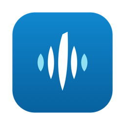

  

<h1 align="center">SinghFlow</h1>

  <b>Speak anywhere on your Mac. SinghFlow types it, cleaned up, where your cursor is.</b> 
  English and Punjabi (ਪੰਜਾਬੀ, written in Gurmukhi). Meeting notes too.

  
  
  

---

## About this repository

This repository holds the **Mac downloads** of SinghFlow and this guide. The source code is private.

Each version is on the [Releases](https://github.com/singhparveen/SinghFlow-releases/releases) page as a `.dmg` file, with notes on what changed and the file's SHA-256 checksum.

## What SinghFlow does

| | |
|---|---|
| 🎙️ **Dictate into any app** | Hold a shortcut, speak, release. The text is typed where your cursor is: email, chat, documents, code editors. |
| ✨ **Clean text** | Filler words go, punctuation and capitals are added, a new topic starts a new paragraph, and spoken lists become numbered lists. Your wording stays the same. |
| ਪੰ **English and Punjabi** | The language is detected as you speak. Punjabi is always written in Gurmukhi, never in Hindi or Urdu script. |
| 📖 **Your dictionary** | Add names and terms once and they are spelled your way every time. |
| 🎨 **Style per app** | Casual, neutral or formal punctuation, depending on the app you are typing in. |
| ✍️ **Rewrite selected text** | Select text and press a shortcut to polish it, or to turn rough notes into a clear AI prompt. |
| 🗓️ **Meeting notes** | Records your microphone and the Mac's sound in the background; nothing joins the call. Then writes a transcript with speakers, a summary, talking points, takeaways and tasks. It can offer to take notes when a call starts. |
| 🕘 **History and Scratchpad** | Every dictation, with what you said and what was typed. A Markdown scratchpad for quick notes. |
| 💲 **Models & Cost** | Choose the speech and cleanup models and see what you spend each month. |

### Examples

| You say | SinghFlow types |
|---|---|
| "um so tomorrow we need to uh finalize the budget and then plan the new labs" | Tomorrow we need to finalize the budget and then plan the new labs. |
| "milk eggs and bread" | Milk, eggs and bread |
| *"Main ajj ghar thoda late aavanga"* (in Punjabi) | ਮੈਂ ਅੱਜ ਘਰ ਥੋੜ੍ਹਾ ਲੇਟ ਆਵਾਂਗਾ। |

## Download and install

1. Download the `.dmg` from the [latest release](https://github.com/singhparveen/SinghFlow-releases/releases/latest).
2. Open it and drag **SinghFlow** into **Applications**.
3. The app is signed but not notarized by Apple, so macOS blocks the first launch:
   - Open SinghFlow from Applications. When macOS says it cannot verify the app, click **Done**.
   - Open **System Settings > Privacy & Security**, scroll down and click **Open Anyway** next to SinghFlow.
   - Confirm with your password or Touch ID. After this it opens normally.
4. Allow the **Microphone**, and switch SinghFlow on under **System Settings > Privacy & Security > Accessibility** so it can type into other apps.

SinghFlow lives in the menu bar. **Read me first.txt** inside the disk image has the full steps, including the optional permissions.

## Set up Azure

SinghFlow sends your speech to **your own** Azure resources. You need:

- An **Azure AI Speech** resource (for MAI-Transcribe).
- An **Azure OpenAI** resource with three deployments: `gpt-4o-transcribe` (backup transcription), `gpt-5.4-mini` (cleanup) and `gpt-4.1` (meeting notes).

In SinghFlow, click the menu bar icon > **Settings > Azure**. On each card, click **Edit** to enter the resource's address (and your deployment names if they differ), then **Add key** to paste its key. Keys are stored in your Keychain only.

## Without Azure

Without Azure keys, only English dictation works, and only on macOS 26:

- In **Models & Cost**, set Transcription to **Apple on-device**. The speech stays on your Mac. Names and technical terms come out less accurately.
- Set Cleanup to **Apple Intelligence**. This needs Apple Intelligence turned on in System Settings. Otherwise your words are typed as heard, with no cleanup.

These need Azure:

- Punjabi dictation. Apple's on-device speech has no Punjabi, so Punjabi speech comes out in English letters, not Gurmukhi.
- Polish and Prompt Engineer (rewriting selected text).
- Meeting transcripts and notes.
- Everything on macOS 15.

## Shortcuts

| Shortcut | What it does |
|---|---|
| Hold <kbd>Control</kbd> <kbd>Option</kbd> <kbd>Space</kbd> | Dictate while held; release to type the text. |
| Tap <kbd>Control</kbd> <kbd>Option</kbd> <kbd>Space</kbd> | Hands-free listening. Tap again to finish, <kbd>Esc</kbd> to cancel. |
| <kbd>Control</kbd> <kbd>Option</kbd> <kbd>Command</kbd> <kbd>V</kbd> | Paste your last dictation as you said it, without cleanup. |
| <kbd>Control</kbd> <kbd>Option</kbd> <kbd>1</kbd> | Polish the selected text. |
| <kbd>Control</kbd> <kbd>Option</kbd> <kbd>2</kbd> | Turn the selected text into a clear AI prompt (Prompt Engineer). |

You can change the shortcuts in Settings, or dictate with a single key instead: <kbd>Fn</kbd>, Right <kbd>Option</kbd> or Right <kbd>Command</kbd>.

## Privacy

- Your history, dictionary, settings and meetings stay on your Mac, in `~/Library/Application Support/SinghFlow`.
- Dictation audio is never saved. Meeting recordings are kept with their transcript and notes until you delete them.
- Speech, transcripts and a little of the text around your cursor (so names and context stay consistent) go only to the Azure resources you set up. With the Apple options they stay on the Mac, except that a dictation Apple's speech cannot handle is sent to your Azure Speech resource if you have added its key.
- Keys are kept in your macOS Keychain.
- Ask everyone in a meeting before you record it.

## Remove it

Quit SinghFlow from its menu bar panel, delete it from Applications, and delete `~/Library/Application Support/SinghFlow`.
